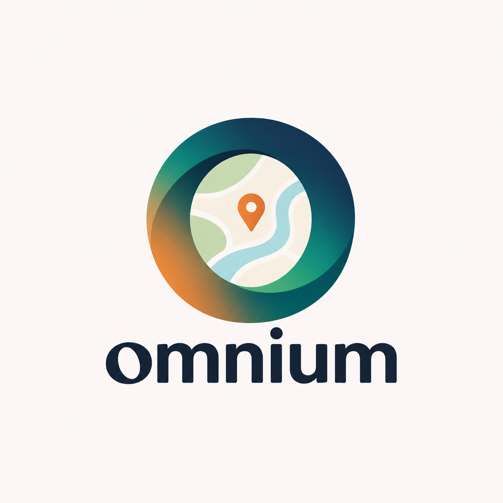

<p align="center"></p>

# Omnium: the team guide

This guide is for us humans. It explains what we are building, how it works, and how to work in the team.
The AI agents read `AGENTS.md` instead. You don't need to read that file.

## What we are building

You type one address in Oslo or Akershus. Omnium shows everything public about that place on one page:
the ground, natural hazards, noise, schools, transport, nature, and statistics about the area.
It gives the place a **rating** with a reason for every score, and a short **AI summary** in plain Norwegian.

There are two pages:

1. **Start page:** almost empty, our logo, and one big field where you type an address.
2. **Address page:** the rating, the most important warnings, the summary, a card per category, and a map.

The look follows our logo: warm paper background, deep navy text, one orange accent. Details are in `docs/DESIGN.md`.

## How to start (let your agent do it)

You don't need to learn the commands. Your coding agent sets up, syncs, commits and pushes for you.

1. Clone the repo once: `git clone https://github.com/glumbis/GeoMap.git`, then open the folder with your coding agent.
2. Start every session by saying: **"I'm <your name>. Get me up to date and tell me my next task."**
   The agent will install what's missing, pull the team's latest work, build the database, start the app and tell you what to do next.
3. Open http://localhost:5173 to see the app.
4. Tell the agent what to build. When something works, it checks it, commits and pushes it to GitHub. It tells you what it pushed.

If you ever want to do it yourself, the commands are in `AGENTS.md` under "Run it" (`npm run setup`, then `npm run dev`).

Just want to run the finished site? `docker run -p 3000:3000 ghcr.io/glumbis/geomap`, then open http://localhost:3000. See `docs/DEPLOY.md`.

## Who does what

The full task lists are in `PLAN.md` under "Roles". In short:

| Person | Role | Owns |
|---|---|---|
| **Lukas** | Lead, API, rating, AI summary | the API core, the address profile, the rating |
| **Sverre** | Data pipeline | ingest scripts, map layer endpoints |
| **Erik** | Frontend and design | everything in `web/`, `docs/DESIGN.md` |
| **Even** | Sources, area statistics, texts, demo | `SOURCES.md`, explanation texts, fact sentences, the demo |

**Own your folders.** You can read everything, but only change files you own. If you need a change in someone else's file, ask them. This keeps us from overwriting each other's work.

We work in three phases:

1. **Skeleton (first hours):** search an address and see a rough page with real data. Ugly is fine.
2. **Fill:** more data, a better rating, the AI summary, the real design.
3. **Demo:** stop adding data. Fix bugs, polish the 5 test addresses, practise the pitch.

## How the app works

```
 Open data (Kartverket, NVE, NGU, SSB, ...)
        │  ingest scripts download it once
        ▼
 data/geomap.duckdb   ← one database file on your own computer
        │  the API asks it questions
        ▼
 API (api/, port 3000)   ← answers like "what is at this address?"
        │  JSON over HTTP
        ▼
 Web app (web/, port 5173)   ← what people see in the browser
```

Everyone has their own copy of the database on their own laptop. Nothing runs in the cloud.

## The main ideas, explained

**Open data.** Norwegian agencies publish map data for free: Kartverket (maps, addresses), NVE (floods, landslides, quick clay), NGU (soil, radon), SSB (statistics) and others. We collect them in `SOURCES.md`.

**Ingest script.** A small program that downloads one dataset, cleans it, and stores it as a table in our database. One script per dataset, in `data/scripts/`. Data files are big, so we never put them on GitHub. We put the *script* on GitHub, and anyone can rebuild the data by running it.

**Database (DuckDB).** One file, `data/geomap.duckdb`, that holds all our data as tables. It needs no server: it's just a file. It understands maps ("spatial"), so it can answer "which flood zone contains this point?" quickly. Only one program can write to it at a time, so the app is stopped while data is being loaded (your agent handles this).

**Coordinates.** Every place on earth has a longitude (east-west, `lng`) and a latitude (north-south, `lat`). Oslo is about `lng 10.75, lat 59.91`. Countries use different ways of writing coordinates (called a *coordinate system* or *CRS*; codes like `EPSG:25833`). Norwegian data often comes in one of those. We convert everything to the standard one, `EPSG:4326` (plain lng/lat), when we load it, so all data lines up.

**Geometry.** The shape of a thing on the map: a **point** (a bus stop), a **line** (a road), or a **polygon** (an area, like a flood zone). Every table has one, in a column called `geom`.

**API and endpoints.** The API is the program between the database and the browser. An *endpoint* is one question it can answer, at one web address. For example `/api/kommuner` returns municipality borders, and `/api/address/<id>/profile` will return everything about one address. Answers are always **JSON**, a simple text format for data that every program understands.

**GeoJSON.** JSON for map shapes. Map layers come from the API as GeoJSON, and the map draws them.

**Bounding box (bbox).** The rectangle of the map you are looking at. The map only asks the API for data inside that rectangle. That way the browser never has to download all of Norway.

**Map and basemap.** The map in the browser uses MapLibre. The *basemap* is the background map picture, made of small square images (*tiles*) from Kartverket. Our own data is drawn on top as *layers* that you can turn on and off.

**Address profile.** The one answer about one address: every data point we found, grouped by category (ground, hazards, environment, location, nature, area), with its source. The rules are in `docs/PROFILE.md`. Two rules matter most:
- **Never fake data.** If we don't have something, we say "Ikke tilgjengelig" (not available). We never fill in a guess.
- **Everything has a source.** Every number shows where it came from.

**Rating.** Each category gets a score from 0 to 100, and the address gets an overall score. A serious problem (for example quick clay) limits the score, so good things nearby can't hide it. We always show the weakest category next to the overall score. If we have too little data, we say "Kan ikke vurderes" (can't rate) and why, instead of showing a number.

**AI summary.** A few sentences in plain Norwegian at the top of the address page, written by an AI model (Claude Haiku). It may only use facts from the profile: it can't add anything. The page labels it "AI-generert". If the AI is unavailable, we show the plain fact sentences instead.

**Test addresses.** Five real addresses with known results (quick clay, flood zone, noisy road, quiet suburb, ski area), in `docs/TEST_ADDRESSES.md`. We use them to check that everything works, and in the demo.

**Git and GitHub.** Git keeps the history of every change. GitHub is the shared copy. Your agent *pulls* (gets the team's changes), *commits* (saves a change with a message) and *pushes* (sends it to GitHub). We all push to the `main` branch, in small steps, many times a day.

**Folders that load themselves.** To avoid editing the same files, new things go in new files and are picked up automatically:
- a new file in `data/scripts/` is a new dataset,
- a new file in `api/src/routes/` is a new endpoint,
- a new file in `web/src/features/` is a new map feature.

## Where things are

| File | What it is |
|---|---|
| `README.md` | This guide (for humans) |
| `PLAN.md` | Product, rating, roles and tasks |
| `docs/DESIGN.md` | Look, page flow, map style |
| `docs/PROFILE.md` | Rules for the address profile |
| `docs/TEST_ADDRESSES.md` | The 5 test addresses |
| `SOURCES.md` | Every data source we found |
| `suggestions.md` | Open ideas and problems to discuss |
| `AGENTS.md` | Instructions for the AI agents |
| `web/` | The website |
| `api/` | The API |
| `data/scripts/` | The ingest scripts |

## Rules in short

- Own your folders; ask before changing someone else's.
- Small steps, pushed often. Let your agent handle git.
- Never put passwords, API keys or data files on GitHub.
- Never fake data. Show what we don't know.
- When time is short, Lukas decides what to cut.
